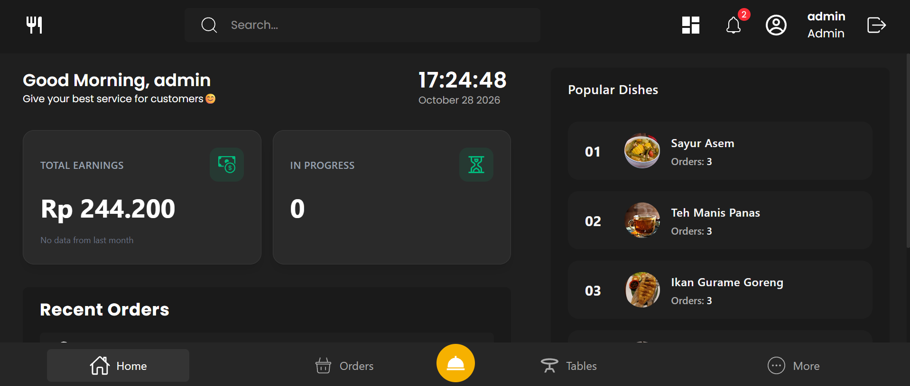
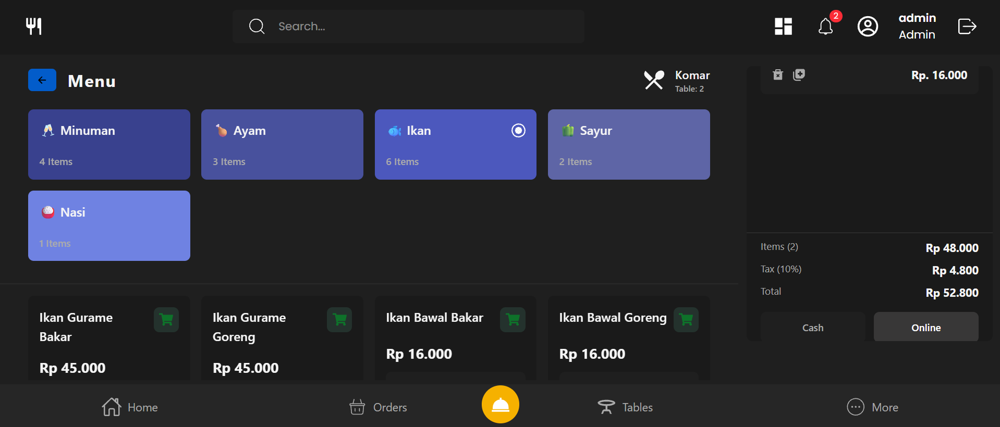
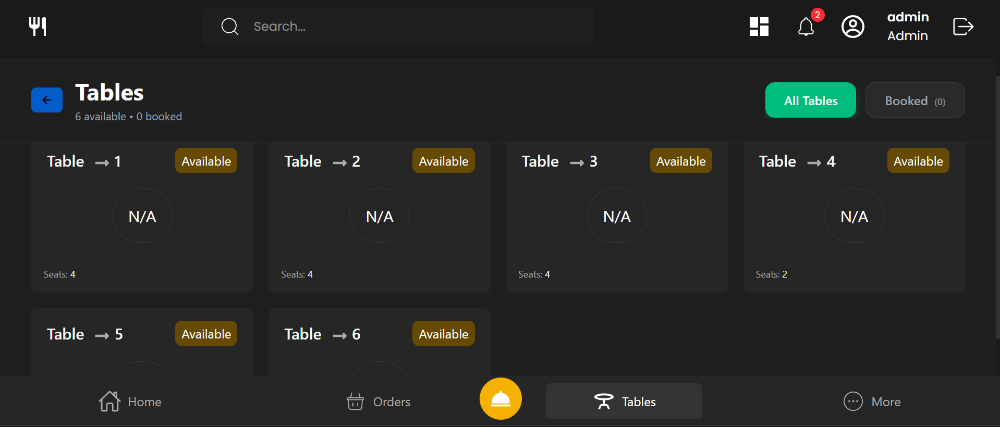
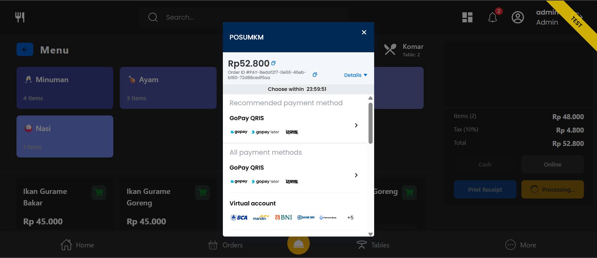

# POS System (MERN)

A Point of Sale (POS) web application for restaurants, built with the MERN stack. It handles order taking, table management, menu and stock, payments, invoices, sales reports, and a dashboard with live statistics.

> **Payment status:** Midtrans is integrated in **Sandbox mode** only. No real money is processed. See [Payment (Midtrans Sandbox)](#payment-midtrans-sandbox).

## Screenshots

| Dashboard                               | Orders                                 |
| --------------------------------------- | -------------------------------------- |
|  |  |

| Tables                                 | Payments                                   |
| -------------------------------------- | ------------------------------------------ |
|  |  |

## Tech Stack

| Layer      | Technology                                                                                                                                             |
| ---------- | ------------------------------------------------------------------------------------------------------------------------------------------------------ |
| Frontend   | React 19, Vite 7, Tailwind CSS 4, React Router 7, Redux Toolkit, TanStack React Query, Axios, Framer Motion, Notistack, date-fns, Lucide / React Icons |
| Backend    | Node.js, Express 5, Mongoose 8, JWT, bcrypt, cookie-parser, CORS, http-errors                                                                          |
| Database   | MongoDB                                                                                                                                                |
| Media      | Cloudinary (via Multer) for image uploads                                                                                                              |
| Payment    | Midtrans (`midtrans-client`), Sandbox                                                                                                                  |
| Deployment | Vercel                                                                                                                                                 |

## Features

- **Authentication**: JWT stored in an `accessToken` cookie, with protected routes via middleware.
- **Dashboard**: greeting, live clock, total earnings with month-over-month change, in-progress orders, recent orders, and popular dishes.
- **Orders**: create orders with customer details and items, filter by status (`in_progress`, `ready`, `completed`), search by customer name or order code, and pagination.
- **Order status flow**: `in_progress` -> `ready` -> `completed`. An order can only be completed after its payment has succeeded.
- **Stock handling**: stock is validated and decreased inside a MongoDB transaction when an order is created, so a failed order does not leave stock half-updated.
- **Tables**: a table is marked as booked when an order is created and released when the order is completed.
- **Menu management**: dishes and categories, with image upload and a low-stock check.
- **Payments**: Midtrans integration (Sandbox) with payment creation, verification, a webhook, and a paginated payment list.
- **Invoices and sales reports**: dedicated API modules for invoices and sales reports.
- **Graceful shutdown**: the server closes the HTTP server and the database connection on `SIGINT` / `SIGTERM`.

## Project Structure

```
POS-System-MERN/
├── backend/
│   ├── app.js              # Express app, CORS, routes, error handlers
│   ├── server.js           # Entry point, DB connection, graceful shutdown
│   ├── config/             # database and app config
│   ├── controllers/
│   ├── middlewares/        # tokenVerification, globalErrorHandler
│   ├── models/
│   ├── routes/
│   └── services/           # business logic (order-service, payment-service, ...)
└── frontend/
    └── src/
        ├── api/            # axios instance + API functions
        ├── components/
        ├── hooks/          # React Query hooks
        ├── pages/
        └── utils/
```

## Getting Started

### Prerequisites

- Node.js 20.19 or newer (required by Vite 7)
- A MongoDB database (local or MongoDB Atlas)
- A [Midtrans](https://midtrans.com) account with **Sandbox** keys
- A Cloudinary account (for image uploads)

### 1. Clone

```bash
git clone <your-repo-url>
cd POS-System-MERN
```

### 2. Backend

```bash
cd backend
npm install
```

Create `backend/.env`:

```env
PORT=8000
MONGODB_URI=<your-mongodb-connection-string>
JWT_SECRET=<a-long-random-secret>
NODE_ENV=development
```

The Midtrans Sandbox keys and the Cloudinary credentials are also required. Their exact variable names are defined in the payment service and the upload configuration of the backend.

Run:

```bash
npm run dev     # development (nodemon)
npm start       # production
```

Health check: `GET http://localhost:8000/` returns `Hello From POS Server!`.

### 3. Frontend

```bash
cd frontend
npm install
```

Create `frontend/.env`:

```env
VITE_BACKEND_URL=http://localhost:8000
```

Run:

```bash
npm run dev       # http://localhost:5173
npm run build     # production build
npm run preview   # preview the build
```

Restart Vite whenever you change `.env`.

### CORS and cookies

The backend only accepts requests from the origins listed in `backend/app.js` (`http://localhost:5173` and the deployed frontend), with credentials enabled. The frontend's Axios instance uses `withCredentials: true` so the auth cookie is sent with every request. If you use a different frontend URL, add it to the `origin` list.

## Payment (Midtrans Sandbox)

Payments use Midtrans in **Sandbox** mode, intended for development and testing only.

- Use the **Sandbox** Server Key and Client Key from your Midtrans dashboard (Settings -> Access Keys, Sandbox environment).
- Do not use production keys while testing.
- Test with the Midtrans sandbox simulators and test cards: <https://docs.midtrans.com/docs/testing-payment-on-sandbox>
- A payment is created for an existing order by its `orderCode` and `paymentMethod`.
- An order can only move to `completed` when its payment has status `success`.
- Midtrans notifies the backend through `POST /api/payment/webhook`. For this to work on a deployed backend, set the notification URL in the Midtrans Sandbox dashboard to `<backend-url>/api/payment/webhook`.

**Before going to production:** switch to production keys, enable production mode, update the notification URL, and verify the webhook signature on the backend. Never commit keys to the repository.

## API Overview

All routes are prefixed with `/api`. Protected routes require a valid `accessToken` cookie.

| Prefix            | Module                   |
| ----------------- | ------------------------ |
| `/api/user`       | Users and authentication |
| `/api/order`      | Orders                   |
| `/api/table`      | Tables                   |
| `/api/payment`    | Payments (Midtrans)      |
| `/api/sales`      | Sales reports            |
| `/api/invoices`   | Invoices                 |
| `/api/categories` | Menu categories          |
| `/api/dishes`     | Menu items               |
| `/api/dashboard`  | Dashboard data           |

### Orders

| Method | Endpoint           | Description                                                                 |
| ------ | ------------------ | --------------------------------------------------------------------------- |
| POST   | `/api/order`       | Create an order                                                             |
| GET    | `/api/order`       | List orders (`status`, `period`, `search`, `page`, `limit`)                 |
| GET    | `/api/order/stats` | Dashboard stats: total earnings, month-over-month change, in-progress count |
| GET    | `/api/order/:id`   | Get an order by id                                                          |
| PATCH  | `/api/order/:id`   | Update order status                                                         |

Example response of `GET /api/order/stats`:

```json
{
  "success": true,
  "data": {
    "totalEarnings": 19800,
    "earningsThisMonth": 19800,
    "earningsChange": null,
    "inProgress": 0
  }
}
```

`earningsChange` is `null` when last month's earnings are 0, because a percentage cannot be calculated from zero.

### Payments

| Method | Endpoint                      | Description                                                                            | Auth                    |
| ------ | ----------------------------- | -------------------------------------------------------------------------------------- | ----------------------- |
| POST   | `/api/payment/create-order`   | Create a payment for an order (`orderCode`, `paymentMethod`)                           | Yes                     |
| POST   | `/api/payment/verify-payment` | Verify a payment status (`order_id`)                                                   | Yes                     |
| POST   | `/api/payment/webhook`        | Midtrans notification callback                                                         | No (called by Midtrans) |
| GET    | `/api/payment`                | Paginated payment list with `totalAmount`, `totalPages`, `currentPage`, `totalRecords` | No                      |

## Deployment

Both apps are deployed on Vercel.

- **Backend:** set the same environment variables as in `backend/.env` in the Vercel project settings.
- **Frontend:** set `VITE_BACKEND_URL` to the deployed backend URL.

## License

ISC, as declared in `backend/package.json`.
